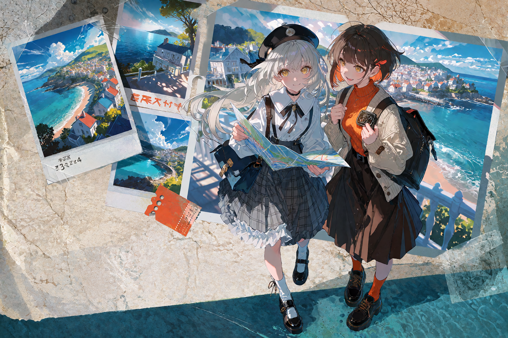
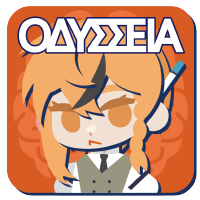

  

<h1 align="center">Hi, I'm shiyue137</h1>

<strong>Giving characters memories, stories room to grow, and worlds the ability to respond.</strong>

AI Entertainment · Interactive Storytelling · Roleplay · World Simulation

<a href="./README.md">简体中文</a> · <strong>English</strong>

---

I build for **AI-powered entertainment, interactive storytelling, and AI roleplay (AIRP)**. I explore how AI can bring characters to life, connecting their memories, actions, and surroundings into coherent, evolving worlds.

Much of my work began in the **SillyTavern ecosystem**, building memory extensions, world interactions, and community tools. I'm now bringing that experience into **Loom Studio**, exploring a new workspace for AI storytelling and roleplay.

## Worlds I'm Building

<table>
  <tr>
    <td width="50%" valign="top">
      
      <h3><a href="https://github.com/The-LoomStudio/LoomStudio">Loom Studio</a></h3>
      
<strong>Weave worlds, interweave stories.</strong>

      
An AI storytelling and agent orchestration workspace I'm developing. It connects characters, world state, branching narratives, and tool execution to explore more open-ended and coherent roleplay experiences.

      
AI Narrative · Agent Runtime · World State

    </td>
    <td width="50%" valign="top">
      
      <h3><a href="https://github.com/shiyue137/Odysseia-Forum-webpage">Odysseia Forum</a></h3>
      
<strong>A place where creators and stories meet.</strong>

      
The open-source forum frontend I built for Odysseia, serving a large Chinese-speaking community for character cards and AIRP. Helping this community share creations, discover characters, and explore stories is a contribution I'm particularly proud of.

      
Community · Character Cards · Frontend

    </td>
  </tr>
</table>

## Roots in SillyTavern

- **[Engram](https://github.com/shiyue137/Engram)** — A memory and RAG extension, exploring how characters can retain their experiences and carry them into future interactions.
- **[The World](https://github.com/shiyue137/sillytavern_TheWorld)** — Bringing world state, maps, weather, and soundscapes into roleplay, making the environment part of the story.

## Tools & Interests

I mainly work with **TypeScript / JavaScript, React, and Node.js**, with some experience in **Python**.

I'm exploring **Agent Runtime / Harness, context and memory management, tool execution, and world-state modeling**, with a focus on how these systems can support engaging, believable, interactive AI worlds.

---

<em>Where will the next story begin?</em>

